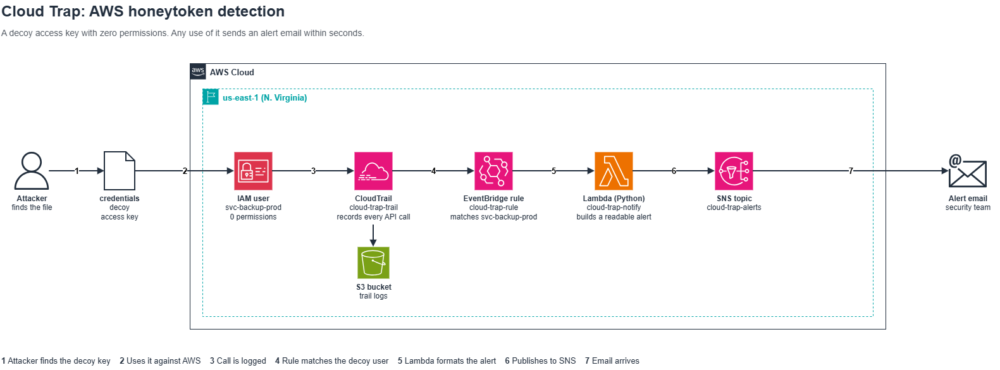
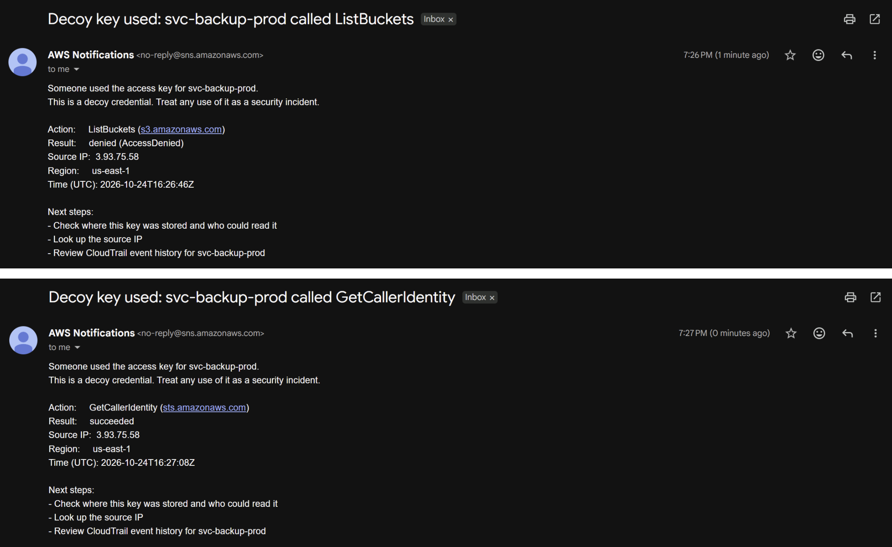

# Cloud Trap

Cloud Trap is a honeytoken for AWS. It is a fake access key that looks like a real backup credential but has no permissions. Nothing legitimate ever uses it, so any call made with it means someone found the key and tried it. When that happens, I get an email within seconds that says what they tried, from which IP, and whether it worked.

I built it by hand in the AWS console to learn how CloudTrail, EventBridge, Lambda and SNS fit together.



## How it works

1. A decoy IAM user, svc-backup-prod, has an access key and zero permissions. The key sits in a file called credentials inside a backup-scripts folder, where an attacker would expect to find something useful.
2. Someone finds the key and uses it, for example with `aws sts get-caller-identity`.
3. CloudTrail records the API call.
4. An EventBridge rule matches any event where the caller is svc-backup-prod.
5. The rule triggers a Lambda function (Python) that pulls out the useful fields and writes a readable alert.
6. The function publishes the alert to an SNS topic.
7. SNS sends it to my email.

## Example alert



The top one was denied and the bottom one went through. Either way, I got an email.

## AWS services used

| Service | Name | Purpose |
|---|---|---|
| IAM | `svc-backup-prod` | Decoy user with an access key and no permissions |
| CloudTrail | `cloud-trap-trail` | Logs API calls in every region |
| S3 | trail bucket | Stores the CloudTrail logs |
| EventBridge | `cloud-trap-rule` | Matches calls made by the decoy user |
| Lambda | `cloud-trap-notify` | Formats the alert |
| SNS | `cloud-trap-alerts` | Sends the alert by email |

Everything runs in us-east-1. IAM is a global service and its CloudTrail events are delivered there, so a rule in another region would miss some of them.

## Things I learned

- EventBridge skips read-only calls by default. My first test with get-caller-identity sent no alert. CloudTrail logged it, but EventBridge rules only see write events unless the rule state is `ENABLED_WITH_ALL_CLOUDTRAIL_MANAGEMENT_EVENTS`. The console can't set this, so I used the CLI instead (the command is in the eventbridge folder). This matters because an attacker's first move is usually a read-only call to check who the key belongs to.
- I gave the function only what it needs. The Lambda role has one extra permission: sns:Publish on this one topic (see the iam folder). If the function were ever abused, it could not do anything else.
- A decoy with zero permissions is safe to leak. Anything that touches a real resource gets denied. The one call that works is GetCallerIdentity, and that works for any valid key because it only tells you whose key it is. So the worst an attacker can do with it is set off my alert.

## Repo layout

```
docs/          architecture diagram (PNG and draw.io source) and alert email screenshot
eventbridge/   event pattern for the rule, and the CLI command for read-only events
iam/           inline policy for the Lambda role
lambda/        the alert function
```

## Testing it

I tested from AWS CloudShell by loading the decoy key as a separate profile and running:

```
aws sts get-caller-identity --profile backup-prod
aws s3 ls --profile backup-prod
```

The first call succeeds (it only returns the key's identity) and the second is denied. Both sent an alert email within a few seconds.

In case you're wondering, the actual decoy key isn't in this repo. I kept it off GitHub on purpose. Bots scan public repos for AWS keys all the time, so it would get picked up within minutes and my inbox would fill up with alerts.

## Limitations

The EventBridge rule only lives in us-east-1, and EventBridge only sees events from its own region. If someone uses the key against a service in another region, for example `aws ec2 describe-instances --region eu-central-1`, CloudTrail still logs it but I won't get an email. Most tools default to us-east-1, so the usual first calls are covered. The fix would be to forward events from the other regions to the us-east-1 event bus.

## Cost

Everything here fits in the AWS Free Tier for this kind of low traffic. The account also has a zero-spend budget that emails me if anything starts costing money.
